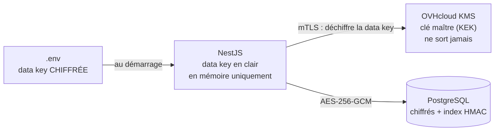

# nestjs-okms-field-encryption

Exemple de **chiffrement par champ** pour une API NestJS + Prisma + PostgreSQL, avec **chiffrement en enveloppe** via [OVHcloud KMS](https://www.ovhcloud.com/fr/identity-security-operations/key-management-service/) (OKMS).

Objectif : qu'une personne qui récupère la base (accès direct, dump, backup volé) ne puisse rien lire des données sensibles.

## Principe



1. La clé maître reste dans le KMS. Elle n'est jamais exportable.
2. La data key n'est stockée que **chiffrée** (dans la config).
3. Au démarrage, le backend la fait déchiffrer par le KMS et la garde **en mémoire**.
4. Les champs sont chiffrés en local, sans appel au KMS par requête.

## Ce qui est protégé

| Scénario | Protégé ? |
|---|---|
| Dump ou backup de la base volé | Oui, uniquement des chiffrés |
| Accès SQL en lecture à la base | Oui |
| Fichier `.env` qui fuit | Oui, les data keys y sont chiffrées |
| Chiffré copié vers une autre ligne ou colonne | Oui, refusé grâce à l'AAD |
| Chiffré modifié | Oui, refusé grâce au tag GCM |
| Serveur applicatif compromis | **Non** : la clé est en mémoire. Révoque le certificat OKMS pour couper l'accès |
| Accès SQL en écriture | **Partiellement** : les données ne sont pas lisibles, mais peuvent être supprimées |

## Format stocké

```
v1.<keyId>.<iv>.<ciphertext>.<tag>
```

- AES-256-GCM, IV aléatoire de 96 bits, encodage base64url.
- AAD = `Modèle.champ.<id>` : un chiffré ne se déchiffre que dans sa ligne et sa colonne d'origine.
- `keyId` permet la rotation sans tout re-chiffrer d'un coup.

Les recherches exactes sur un champ chiffré passent par un **index aveugle** (HMAC-SHA256 avec une clé dédiée, normalisé, cloisonné par colonne).

## Structure

```
src/
  crypto/
    okms.client.ts       client REST OKMS (mTLS, retries)
    crypto.service.ts    chiffrement, déchiffrement, index aveugle
    crypto.module.ts     module global
  clients/
    clients.repository.ts  exemple : chiffrer / déchiffrer / chercher / rotation
  prisma/                  PrismaService (Prisma 7 + adapter pg)
prisma/schema.prisma       modèle Client avec champs chiffrés
scripts/generate-datakey.ts
test/crypto.test.ts
```

## Mise en place

1. Commande un KMS dans le Control Panel OVHcloud, dans la région de ton serveur.
2. Crée un credential (certificat client) avec uniquement les droits sur les data keys, et une service key AES-256.
3. Installe :
```bash
npm install
npm run generate
```
4. Copie `.env.example` en `.env` et remplis les infos OKMS.
5. Génère la clé de chiffrement et la clé d'index :
```bash
npm run datakey -- k1
npm run datakey -- idx
```
6. Colle les sorties dans `FIELD_KEYS` et `BLIND_INDEX_KEY`, et garde une copie dans ton gestionnaire de mots de passe.
7. Importe `AppModule` (ou `CryptoModule` dans ton propre module racine).

## Rotation de clé

1. Génère `k2` :
```bash
npm run datakey -- k2
```
2. Passe `FIELD_KEYS=k1:…,k2:…` et `FIELD_KEY_CURRENT=k2`, puis redémarre.
3. Lance `ClientsRepository.rotateKeys()` (dans un script ou une commande d'admin).
4. Quand plus aucune ligne n'utilise `k1`, retire-la de `FIELD_KEYS`.

`BLIND_INDEX_KEY` ne tourne pas avec les autres : la changer impose de recalculer tous les index.

## Pièges

- **Ne supprime jamais la service key OKMS** : toutes les données deviennent définitivement illisibles. Désactive-la plutôt.
- **Perdre les data keys chiffrées = perdre les données.** Sauvegarde-les ailleurs que dans le `.env`.
- **L'`id` est généré par l'appli** (`randomUUID()`), car il sert d'AAD : pas de `@default()` sur les modèles chiffrés.
- On ne peut ni trier, ni faire de `contains` sur un champ chiffré. Laisse en clair ce qui sert au tri, si ce n'est pas sensible.
- Le KMS devient une dépendance de démarrage : l'appli refuse de démarrer s'il est injoignable (après 5 tentatives).

## Tests

```bash
npm test
```

Les tests utilisent un faux KMS et vérifient : aller-retour, non-déterminisme, refus d'un chiffré déplacé ou modifié, rotation, index aveugle, et absence de donnée en clair en base.

Les endpoints OKMS utilisés (`/v1/servicekey/{keyId}/datakey` et `/datakey/decrypt`) viennent de la [doc OVHcloud](https://docs.ovhcloud.com/en/guides/manage-and-operate/kms/kms-usage). Vérifie-les sur le Swagger de ta région (`https://<region>.okms.ovh.net/swagger/`).

## Licence

MIT
