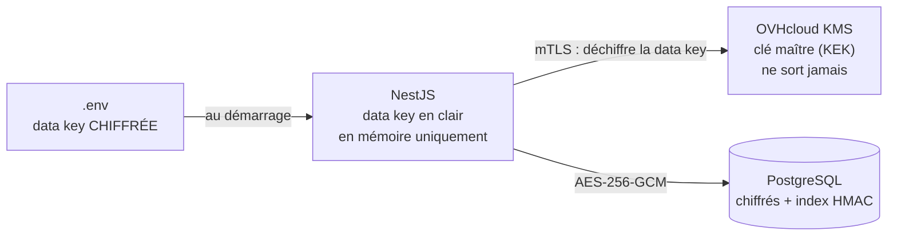

# nestjs-okms-field-encryption

Exemple de **chiffrement par champ** pour une API NestJS + Prisma + PostgreSQL, avec **chiffrement en enveloppe** via [OVHcloud KMS](https://www.ovhcloud.com/fr/identity-security-operations/key-management-service/) (OKMS).

Objectif : qu'une personne qui récupère la base (accès direct, dump, backup volé) ne puisse rien lire des données sensibles.

Le chiffrement est fait par une **extension Prisma** : le code métier reste du Prisma ordinaire.

```ts
// src/prisma/encrypted-fields.ts : le seul endroit à configurer
export const encryptedFields = {
  Client: { siret: { index: "siretIdx" }, iban: {}, notes: {} },
  Invoice: { label: {} },
};

// Dans un service NestJS
await db.client.create({ data: { name: "ACME", siret: "12345678900012", iban: "FR76..." } }); // chiffré en base
await db.client.findFirst({ where: { siret: "123 456 789 00012" } });                         // via l'index aveugle
await db.client.findMany({ include: { invoices: true } });                                     // tout déchiffré
```

## Principe



1. La clé maître reste dans le KMS. Elle n'est jamais exportable.
2. La data key n'est stockée que **chiffrée** (dans la config).
3. Au démarrage, le backend la fait déchiffrer par le KMS et la garde **en mémoire**.
4. Les champs sont chiffrés en local, sans appel au KMS par requête.

## Ce qui est protégé

| Scénario | Protégé ? |
|---|---|
| Dump ou backup de la base volé | Oui, uniquement des chiffrés |
| Accès SQL en lecture à la base | Oui |
| Fichier `.env` qui fuit | Oui, les data keys y sont chiffrées |
| Chiffré copié vers une autre ligne ou colonne | Oui, refusé grâce à l'AAD |
| Chiffré modifié | Oui, refusé grâce au tag GCM |
| Valeur en clair injectée à la place d'un chiffré | Oui, refusée à la lecture |
| Serveur applicatif compromis | **Non** : la clé est en mémoire. Révoque le certificat OKMS pour couper l'accès |
| Accès SQL en écriture | **Partiellement** : les données ne sont pas lisibles, mais peuvent être supprimées |

## Format stocké

```
v1.<keyId>.<iv>.<ciphertext>.<tag>
```

- AES-256-GCM, IV aléatoire de 96 bits, encodage base64url.
- AAD = `Modèle.champ.<id>` : un chiffré ne se déchiffre que dans sa ligne et sa colonne d'origine.
- `keyId` permet la rotation sans tout re-chiffrer d'un coup.

Les recherches exactes sur un champ chiffré passent par un **index aveugle** (HMAC-SHA256 avec une clé dédiée, normalisé, cloisonné par colonne).

## Ce que fait l'extension

| Opération | Comportement |
|---|---|
| `create`, `createMany`, `upsert` | Chiffre les champs configurés, remplit l'index aveugle, génère l'`id` s'il manque |
| `update` | Chiffre ; si le `where` n'est pas sur `id`, retrouve l'`id` d'abord (il sert d'AAD) |
| `updateMany` | Si un champ chiffré est modifié : une mise à jour par ligne dans une transaction |
| Lectures (`find*`, `include`, `select`) | Déchiffre, y compris dans les relations incluses ; ajoute `id` au `select` si besoin |
| `where` sur un champ indexé | Égalité, `not`, `in`, `notIn` réécrits vers l'index aveugle (insensible à la casse et aux espaces) |
| `contains`, `startsWith`, tri, `groupBy`, agrégats sur un champ chiffré | **Refusés** avec une erreur explicite |
| Filtre relationnel ou écriture imbriquée touchant un champ chiffré | **Refusés** plutôt que d'écrire en clair ou de ne rien trouver |
| `$queryRaw`, `$executeRaw` | Non concernés : tu lis et écris les chiffrés bruts |
| `db.$rotateEncryptionKeys()` | Re-chiffre avec la clé courante tout ce qui est sur une ancienne clé |

Compatible **Prisma 7**. Prisma 8 (en release candidate au moment d'écrire) supprime `$extends` au profit de middlewares et de codecs : un portage sera nécessaire quand il sera stable.

## Structure

```
src/
  crypto/
    okms.client.ts               client REST OKMS (mTLS, retries)
    crypto.service.ts            AES-256-GCM, index aveugle, rotation
    crypto.module.ts             module global
  prisma/
    field-encryption.extension.ts  l'extension Prisma (indépendante de NestJS et d'OKMS)
    encrypted-fields.ts            liste des champs chiffrés
    prisma.module.ts               client étendu injectable : @Inject(PRISMA) db: PrismaDb
  clients/
    clients.service.ts           exemple de code métier, sans une ligne de crypto
prisma/schema.prisma
scripts/generate-datakey.ts
test/
  crypto.test.ts                 tests unitaires du chiffrement
  extension.int.test.ts          tests d'intégration contre PostgreSQL
```

L'extension ne dépend que de l'interface `FieldCrypto` (`encrypt`, `decrypt`, `blindIndex`, `needsRotation`) : tu peux la réutiliser sans NestJS ou avec un autre KMS.

## Mise en place

1. Commande un KMS dans le Control Panel OVHcloud, dans la région de ton serveur.
2. Crée un credential (certificat client) avec uniquement les droits sur les data keys, et une service key AES-256.
3. Installe :
```bash
npm install
npm run generate
```
4. Copie `.env.example` en `.env` et remplis les infos OKMS.
5. Génère la clé de chiffrement et la clé d'index :
```bash
npm run datakey -- k1
npm run datakey -- idx
```
6. Colle les sorties dans `FIELD_KEYS` et `BLIND_INDEX_KEY`, et garde une copie dans ton gestionnaire de mots de passe.
7. Liste tes champs dans `src/prisma/encrypted-fields.ts`. Chaque modèle chiffré doit avoir un `id String`, et chaque index une colonne `String? @unique`.
8. Importe `CryptoModule` et `PrismaModule` dans ton module racine, puis injecte `@Inject(PRISMA) db: PrismaDb`.

## Chiffrer des données existantes

1. Ajoute le champ dans `encrypted-fields.ts` et passe `{ allowPlaintext: true }` à `fieldEncryption()`.
2. Relis puis réécris chaque ligne (un `update` avec la même valeur suffit : l'extension la chiffre).
3. Retire `allowPlaintext` : toute valeur restée en clair sera désormais refusée.

## Rotation de clé

1. Génère `k2` :
```bash
npm run datakey -- k2
```
2. Passe `FIELD_KEYS=k1:…,k2:…` et `FIELD_KEY_CURRENT=k2`, puis redémarre.
3. Lance `db.$rotateEncryptionKeys()` (dans un script ou une commande d'admin).
4. Quand plus aucune ligne n'utilise `k1`, retire-la de `FIELD_KEYS`.

`BLIND_INDEX_KEY` ne tourne pas avec les autres : la changer impose de recalculer tous les index.

## Pièges

- **Ne supprime jamais la service key OKMS** : toutes les données deviennent définitivement illisibles. Désactive-la plutôt.
- **Perdre les data keys chiffrées = perdre les données.** Sauvegarde-les ailleurs que dans le `.env`.
- **L'`id` doit être une String connue avant l'insert** : l'extension la génère si elle manque. Pas d'`autoincrement()` sur un modèle chiffré.
- On ne peut ni trier, ni faire de `contains` sur un champ chiffré. Laisse en clair ce qui sert au tri, si ce n'est pas sensible.
- Dans une `$transaction` interactive, les recherches d'`id` faites par l'extension (`update` hors `id`, `upsert`, `updateMany`) passent hors de la transaction. Préfère `where: { id }` dans ce cas.
- Ne branche pas Better Auth sur le client étendu : ses tables ont leur propre protection (hash, `encryptOAuthTokens`).
- Le KMS devient une dépendance de démarrage : l'appli refuse de démarrer s'il est injoignable (après 5 tentatives).

## Tests

```bash
npm test
```

Les tests utilisent un faux KMS. Les tests d'intégration tournent contre un vrai PostgreSQL (dans la CI, ou en local avec `DATABASE_URL` puis `npx prisma db push`) et vérifient en SQL brut qu'aucune donnée sensible n'est en clair.

Les endpoints OKMS utilisés (`/v1/servicekey/{keyId}/datakey` et `/datakey/decrypt`) viennent de la [doc OVHcloud](https://docs.ovhcloud.com/en/guides/manage-and-operate/kms/kms-usage). Vérifie-les sur le Swagger de ta région (`https://<region>.okms.ovh.net/swagger/`).

## Licence

MIT
